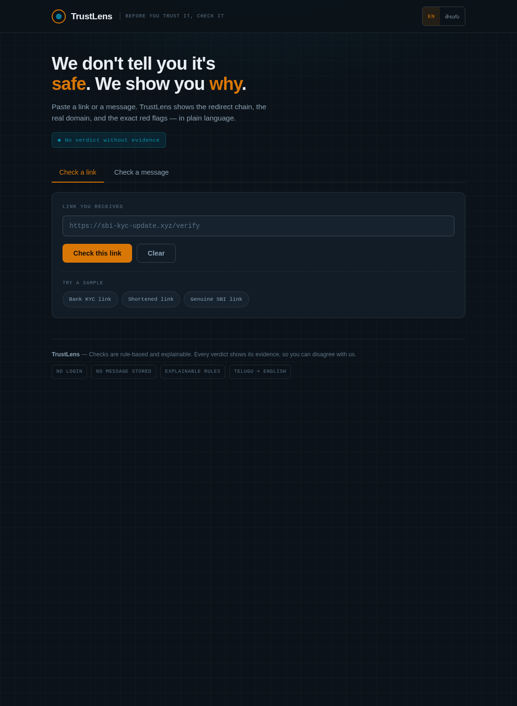
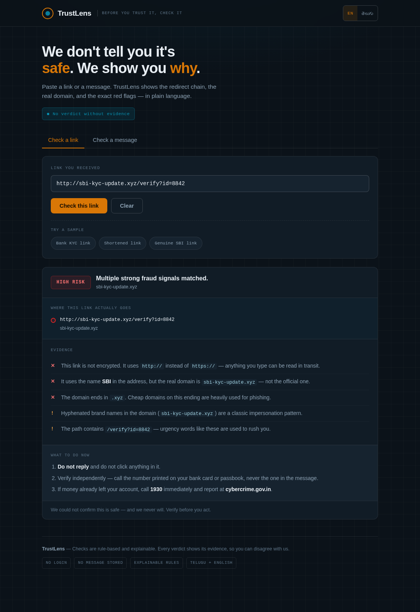

# TrustLens — working prototype

This folder holds a **self-contained, dependency-free working prototype** of the
TrustLens checking flow: link analysis and message analysis, with an evidence
card and English / Telugu output.

It exists so the project can be demonstrated end-to-end before the full
React + FastAPI build in `../frontend` and `../backend` is complete.

## Run it

No build step, no dependencies, no API keys, no network calls.

```bash
# from the repository root
python3 -m http.server 8000
# then open http://localhost:8000/prototype/
```

Or open `prototype/index.html` directly in any browser.

## What works today

**Link check**

- Redirect path display for the built-in samples
- Shortened-link detection (`bit.ly`, `tinyurl`, `t.co`, `rb.gy`, and 10 more)
- Brand impersonation — e.g. `sbi-kyc-update.xyz` claiming to be SBI
- Abused TLDs (`.xyz`, `.top`, `.click`, `.icu`, `.online`, …)
- Punycode (`xn--`) lookalike domains and raw IP-address hosts
- Deep subdomain chains and hyphenated brand names
- Urgency words in the path (`/verify`, `/kyc`, `/block`, `/refund`)
- Confirmation when a domain is on the verified official-domain list

**Message check**

13 explainable rules: OTP/PIN/CVV requests, "digital arrest", law-enforcement
impersonation, pay-to-get-selected, lottery, KYC expiry threats, utility
disconnection, shortened links, UPI collect requests, artificial urgency,
Aadhaar/PAN requests, free-email senders, forced WhatsApp/Telegram groups.
Any link inside the message is passed through the link checker automatically.

**Both**

- Four verdict states: High risk / Suspicious / Cannot confirm / No red flags found
- Every verdict renders the exact rules that fired — the user can read the
  reasoning and disagree with it
- The app never reports "safe" unless the domain is on the verified list
- Full interface and verdicts in English and Telugu
- Six built-in demo samples

## Screenshots





## Design principle

> We don't tell you it's *safe*. We show you *why*.

The detection engine is a transparent, weighted rule set — not a model. Every
result is reproducible, auditable and instant, and no verdict is shown without
its evidence.

## Not in this prototype

- Live redirect tracing for arbitrary pasted links (needs a server-side fetch;
  planned for the FastAPI service in `../backend`)
- Image / screenshot / OCR input
- Natural-language explanation layer
- Persistence of any kind — nothing the user pastes is stored

## Not legal or financial advice

If money has already been lost, call **1930** and report at
**cybercrime.gov.in**.
